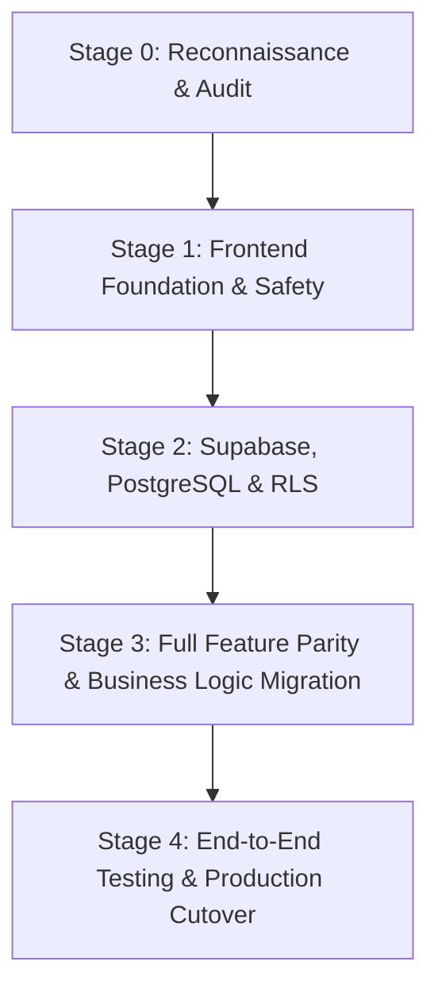

# CampusBite Migration Plan & Feature Parity Matrix

## 1. Overview & Strategy

CampusBite is migrating from a single-page vanilla JavaScript prototype utilizing browser `localStorage` to a modern, decoupled web application built on **React, TypeScript, Vite, and Supabase**.

To guarantee zero downtime and eliminate regression risks, this migration follows an **additive, gated migration strategy**:
- The legacy application at root (`index.html`, `app.js`, `styles.css`) remains live and serves as the reference implementation.
- GitHub Pages continues to deploy from root until the Stage 1 + Stage 2 requirements have achieved full parity and received explicit production sign-off.
- The new web application is built strictly within `web/`.

---

## 2. Feature Parity & Migration Status Matrix

| Feature | Legacy Behavior (`app.js`) | Verification Status | Migrated to `web/`? | Target Production Architecture | Relevant Tests | Limitations & Notes |
| :--- | :--- | :--- | :--- | :--- | :--- | :--- |
| **Menu Discovery** | In-memory array & `localStorage`, filtered by veg/prep | Verified (26/26 browser tests) | Partial (Stage 1 Fixtures) | Supabase `food_items` table with real-time availability | `tests.html`, `app.test.tsx` | Stage 1 uses curated fixtures |
| **BREAK-FIT™ Filter** | Filters items by `prepTimeMins <= selectedTime` | Verified | Yes (Component ready) | Pure domain function combined with dynamic kitchen prep estimates | `app.test.tsx` | Needs live queue telemetry in Stage 2 |
| **LAST PLATE™ Surplus** | Client-side listing & quantity decrement | Verified | Partial (UI & reservation hook) | Supabase atomic RPC with row-level locks preventing race conditions | `tests.html` (Test 18) | Concurrency requires DB transaction |
| **Student Cart & Ordering**| `localStorage` cart, generates local order ID | Verified | Shell implemented | Secure Supabase insert with user JWT & idempotency key | `tests.html` (Test 1-5), `app.test.tsx` | No browser persistence in Stage 1 |
| **Idempotent Requests** | Client-side idempotency log in `localStorage` | Verified | Target behavior defined | Database table `idempotency_keys` with unique constraints | `tests.html` (Test 15) | Pure browser state is insufficient for multi-device |
| **Kitchen Operations Kanban** | Client-rendered status board, manual state flips | Verified | Yes (Interactive board) | Supabase Realtime channel listening to `orders` table updates | `tests.html` (Test 12-14), `app.test.tsx` | Role authorization required in Stage 2 |
| **Preparation Batches** | Grouping like items into prep batches | Verified | Target behavior defined | Kitchen aggregation service / SQL view grouping open orders | `tests.html` (Test 10) | Preserved in legacy; targeted for Stage 2 |
| **Inventory Ledger** | Local deductions on order placement | Verified | Domain types defined | PostgreSQL triggers on `order_items` decrementing `inventory` | `tests.html` (Test 6-9) | Critical risk if client-enforced |
| **Multi-Language Support** | In-app dictionary (EN, HI, TE) | Verified | Yes (Header language selector) | i18next or lightweight typed localization dictionary | Browser visual audit | Extended language toggle in header |
| **JavaFX Desktop Client** | Separate Java desktop app with Maven | Verified (Preserved untouched) | Not Applicable | Remains standalone JavaFX desktop app | `mvn test` | Academic project, isolated from web migration |

---

## 3. Migration Stages & Dependencies

### Stage 1: Frontend Foundation & Safe Migration (Current)
- Establish React 18, TypeScript 5, Vite 5 in `web/`.
- Strict typing, linting, Vitest suite, and accessible design tokens.
- Maintain legacy tests and ensure 26/26 baseline passes.
- Dedicated CI workflow `.github/workflows/ci.yml`.
- No cutover to GitHub Pages.

### Stage 2: Supabase, PostgreSQL & Row Level Security (Next)
- Deploy PostgreSQL schema (`supabase/migrations/`).
- Enforce RLS policies for students and kitchen staff.
- Implement atomic PostgreSQL functions for inventory deduction and LAST PLATE reservations.
- Integrate `@supabase/supabase-js` with secure Auth workflows.

### Stage 3: Feature Migration & Realtime Sync
- Connect React features to live Supabase backend.
- Replace development fixtures with live reactive queries.
- Supabase Realtime for instant order status reflection on both Student and Kitchen dashboards.

### Stage 4: Staging Validation & Production Cutover
- Comprehensive Playwright E2E testing against staging environment.
- Verify security boundaries and race-condition resistance.
- Update GitHub Pages deployment workflow to build and deploy `web/dist`.
- Decommission legacy root assets with clean rollback tags.

---

## 4. Risk Analysis & Mitigation

| Risk | Impact | Probability | Mitigation Strategy |
| :--- | :--- | :--- | :--- |
| **Accidental Production Cutover** | Broken live site on GitHub Pages | Low | Strict condition: `.github/workflows/deploy.yml` remains untouched; CI runs on separate workflow. |
| **Concurrent LAST PLATE Overbooking** | Customer dissatisfaction, inventory mismatch | High (in prototype) | Stage 2 will introduce atomic PostgreSQL transactions with `SELECT ... FOR UPDATE`. |
| **Client-Side Auth Tampering** | Unauthorized order status modifications | High (in prototype) | Replaced with Supabase JWT authentication and PostgreSQL RLS policies. |
| **JavaFX Build Breakage** | Academic desktop application failure | Low | JavaFX Maven files (`pom.xml`, `src/main/`) are strictly quarantined and preserved. |
| **Regression in Core Business Logic** | Lost calculations for prep time or batches | Medium | Legacy tests preserved; pure domain functions ported with exact unit test coverage. |

---

## 5. Rollback Considerations

Because Stage 1 makes zero modifications to the production deployment path or the root application entry points:
- If issues occur in `web/`, the live production site is completely unaffected.
- If necessary, the entire `web/` directory can be reset without altering the running system.
- Git tags will be established before any future production publishing switch.

---

## 6. Conditions for Production Cutover (Stage 4 Gate)

Before the production publishing source is switched from root to `web/dist`, ALL of the following criteria must be satisfied:
1. All 10 core features in the parity matrix are fully migrated and verified.
2. Supabase backend is provisioned with passing RLS security assertions.
3. Automated Playwright E2E test suite passes in CI across mobile and desktop viewports.
4. Concurrency testing confirms zero duplicate LAST PLATE claims under simulated race conditions.
5. Formal release sign-off is granted by project stakeholders.
